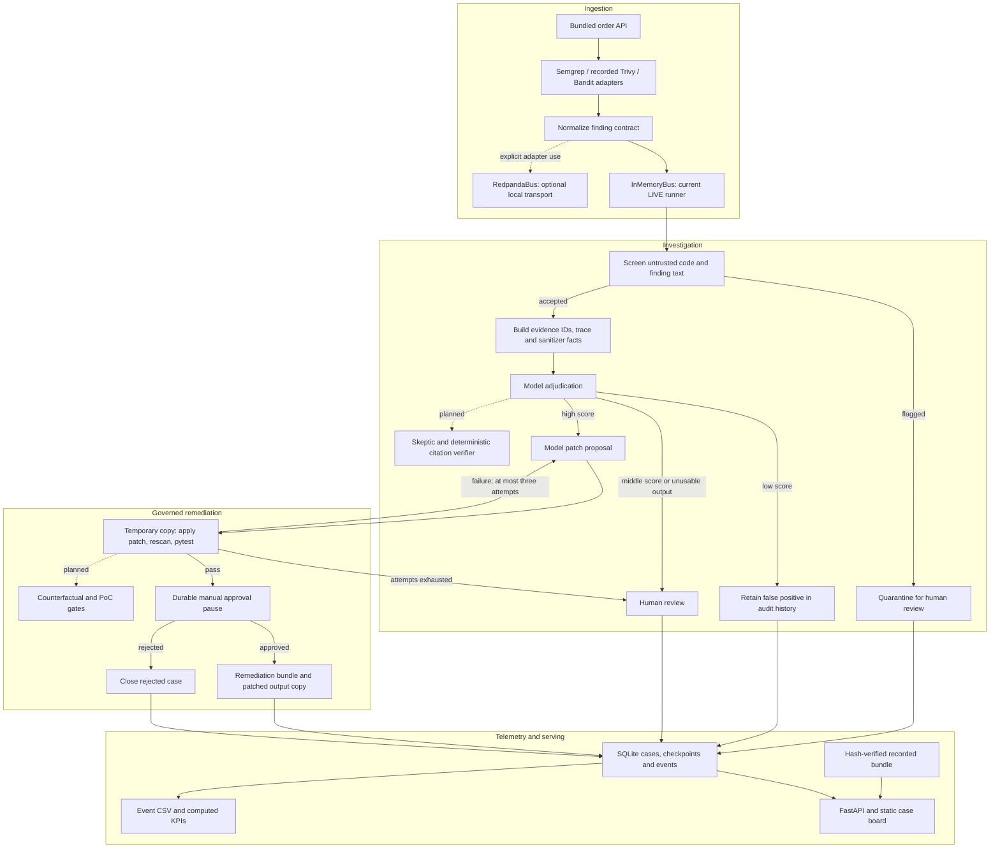

# PulseGuard architecture

PulseGuard turns scanner findings from a bundled Flask order service into reviewable security
cases and remediation bundles. A language model explains the evidence and proposes a small patch;
deterministic checks decide whether the patch can advance to approval. The output is a patch,
review description and supporting evidence. The application does not open or merge a remote PR.

This description reflects the `s3-infra` worktree on 31 October 2026. Some UI panels already support
the upcoming S2 responses, but a panel's presence does not establish that its backend exists.
See [component provenance](PRE_EXISTING_COMPONENTS.md) for source paths and implementation status.

## Pipeline planes



**Ingestion.** The scanner modules parse Semgrep taint results, Bandit JSON and recorded Trivy
dependency reports into a common finding. The current local LIVE entry point in
`pulseguard/run.py` runs Semgrep and publishes findings through `InMemoryBus`; having a scanner
adapter does not mean that entry point runs every scanner. Trivy report provenance distinguishes
recorded evidence from synthetic test fixtures. The current Trivy subprocess requests vulnerability
scanning only; a secrets scan is not an implemented gate.

**Investigation.** The guard screens code and finding text before model use. Flagged cases stop in
quarantine with a suspected-manipulation reason. Accepted cases receive an evidence block built
from scanner locations, dataflow steps and sanitizer facts. The adjudicator returns a score,
evidence IDs and short explanations of dataflow, constraints, context and verdict. The current
bands are confirmed at 0.7 or above, uncertain from 0.3 to below 0.7, and false positive below 0.3.
Invalid adjudication output routes to human review. A false positive remains in the store and log.

**Remediation.** A confirmed finding can request a structured PatchSet. Contract and trace-scope
checks reject invalid proposals. The sandbox copies the bundled target into temporary storage,
applies the patch there, requires the selected Semgrep rule count to move from one to zero, and
runs the target's regression tests. Failure feeds back into another proposal, with three total
attempts. Exhaustion stops for human review. A passing patch pauses at a LangGraph interrupt;
manual approval resumes the durable case. Bundling writes a diff, PR description, metadata and
patched output copy without changing the source target or a remote repository.

The principle is to try to disprove a proposal before acting on it. In this snapshot, rescanning,
tests, schema validation and patch-scope checks provide that constraint. A separate verifier for
every cited evidence item is still planned; high model confidence alone is not a proof of
exploitability. Temporary-directory execution is a bounded test harness, not an OS isolation
boundary for arbitrary repositories.

**Telemetry and serving.** SQLite stores cases and events; LangGraph manages checkpoint tables in
the same database. The JSONL tracer redacts common secret patterns and validates trace events.
The API serves the static HTML/JavaScript UI, evidence, patch reports and trace. Event export uses
`case_id, activity, timestamp, resource, priority, score, run_mode`, with UTC timestamps. KPIs are
computed from stored events: remediation duration, false positives, approval counts and rework.
An absent completion produces a null remediation duration. CSV compatibility does not imply a
deployed process-mining integration.

## Governance and implementation boundaries

Every passing patch currently requires a human decision. Replay decisions are explicitly simulated.
The UI has space for verification, counterfactual, priority, bus health and rollback information,
and displays unavailable states when data is absent. The following backend capabilities are
**planned**, not implemented in this checkout:

| Planned capability | Intended behavior |
| --- | --- |
| Skeptic and evidence verifier | Challenge uncertain conclusions; abstain and escalate when evidence fails checking. |
| Counterfactual check | Compare original and patched-code judgments as an additional gate. |
| Topology risk scoring | Calculate a priority from a service graph; no trained security GAT is claimed. |
| Tiered approval and freshness watchdog | Permit verified P2/P3 automation, retain human approval for P0/P1, and use advice-only behavior for stale input. |
| Fix-history rollback | Restore the patched bundle output copy from stored snapshots. |
| PoC witness and constraint solving | Exercise a bounded before/after witness; optionally check a supported validator subset. |
| Image topology extraction | Validate model-extracted topology, with a fixture fallback. |
| Token-gated HTTP run start | Start a bounded LIVE run from the API; no such route exists today. |

## REPLAY and LIVE

`PG_MODE=replay` is the default in the Docker image, Compose and Render configuration. Startup
verifies the replay manifest before seeding SQLite. A failed manifest check leaves the service
unready instead of silently fabricating a case. The bundled recorded run identifies its original
model calls; opening it does not call a model or run scanners again. Approve/reject buttons in
REPLAY simulate a decision and leave recorded results unchanged.

Local LIVE runs use `python -m pulseguard.run --target demo_target/order_api`, configured with
`PG_MODEL_BASE_URL`, `PG_MODEL_NAME` and `PG_MODEL_API_KEY`. Only that bundled target is accepted.
The API's LIVE mode exposes stored local LIVE cases and can resume their approvals; it does not
yet start a run. Storage defaults to the system temporary directory. Render has no persistent
disk declared in this repository, so new runtime state is not promised across restarts.

The recorded artifacts name `muse-spark-1.3-contributor` at `opencode.ai` for the adjudicator and
remediator, with structured-output, latency and token-usage metadata. Muse Spark is a Meta model
family ([Meta introduction](https://ai.meta.com/blog/introducing-muse-spark-msl/)); the exact hosted
model identifier and endpoint here come from the stored call metadata, not an independent model
attestation. Skeptic calls and multimodal extraction are not present in that recorded run.
The repository does not establish the provider's prompt-retention or training terms.

## Data model

| Contract or storage object | Main contents |
| --- | --- |
| Finding | Case ID, deduplication fingerprint, scanner/rule, location, lifecycle state, evidence IDs, trace, optional CVE and extension object. |
| Verdict | Exploitability, score/band, cited IDs, four explanation fields, role/model and case ID. |
| PatchSet | Exact old/new replacements on relative paths, rationale, attempt and lifecycle state. |
| Event | Sequence, case ID, activity, UTC time, resource and attributes. |
| SQLite | `runs`, `cases`, `evidence`, `verdicts`, `patches`, `approvals`, `events`, materialized `runtime_state`, plus LangGraph checkpoints. WAL mode supports the small local workflow. |
| Replay bundle | Run/case JSON, evidence and verdicts, model metadata, patch output, trace and SHA-256 manifest. Hashes establish integrity, not independent scanner or provider attestation. |

JSON Schema remains the validation authority for allowed states, ID formats, unique evidence IDs
and location bounds. `contracts/finding.avsc` carries the same finding field names using Avro
records, enums and arrays. Its nullable defaults represent optional fields. The unrestricted
`extra` object travels as a JSON string; the adapter restores it to an object. A
`pulseguard.fields` Kafka header preserves omitted fields versus an explicit nullable `cve_id`.
This is schemaless Avro, without a Schema Registry or Confluent framing prefix.

## Optional local streaming

`RedpandaBus` in `pulseguard/bus/redpanda.py` is a new implementation informed by the
quant-foundation-gat producer/consumer design. It keeps `publish(topic, value, key=None)` and
`subscribe(topic, handler)` with an unsubscribe callable. Native Kafka imports are lazy; the
default package and Render path need no `stream` extra. The optional adapter validates the JSON
contract before encoding and after decoding, waits for publication acknowledgement, dispatches
callbacks on a polling thread, and commits offsets after successful handlers. Failures raise
`RedpandaError`; background failure stops consumption and surfaces on the next public operation.
Call `close()` or use a context manager.

The demo uses partition zero so per-topic offsets fit the existing `Message` interface. Delivery
is at least once: consumers must tolerate duplicates after a failure. `replay()` and `size()`
describe messages observed by this adapter instance, not a broker-wide history query. Callbacks
run asynchronously relative to `publish`; `background=False` plus `poll()` supports a caller-owned
loop. External Avro publishers without the field-presence header get null optional fields omitted.

With Docker running, Compose is designed to provide the broker, Console on
`http://localhost:8080`, and the replay app on `http://localhost:8000`:

```sh
docker compose up --build
```

`PG_MODE` defaults to `replay`; `PG_BUS` defaults to `memory`. `PG_BUS=redpanda` is an **opt-in
configuration seam, with runner integration still planned**: `live_run()` currently constructs
`InMemoryBus` directly and does not inspect that variable. Setting it alone does not turn replay
playback into broker traffic. Use `RedpandaBus("localhost:19092")` explicitly in a local producer or
consumer; containers use `redpanda:9092`. Render continues to use InMemoryBus and needs no broker.

The Compose build installs the optional streaming dependencies without altering the Render
Dockerfile. It uses `dockerfile_inline` (Compose 2.17+). Broker, Console and app healthchecks are
declared, and exposed ports bind to loopback. Docker is not running on the development host used
for this change: configuration parsing and fake-client tests do not constitute a container build,
broker integration test or healthcheck execution.
